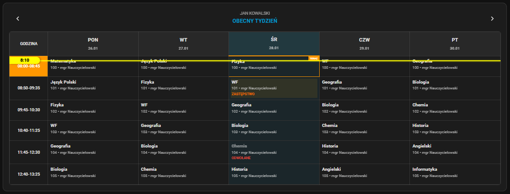
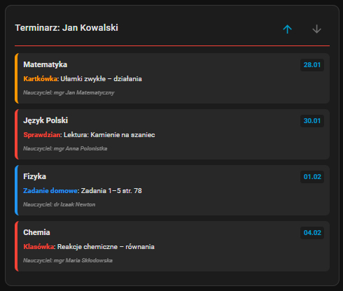
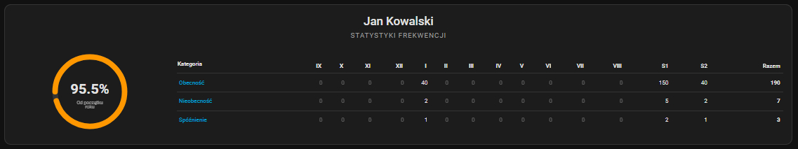
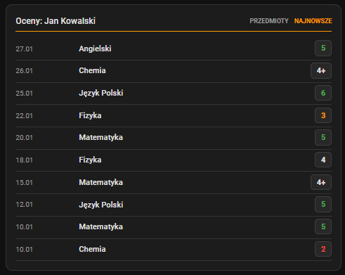
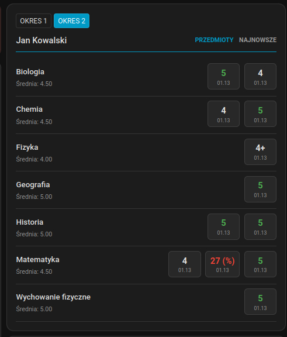
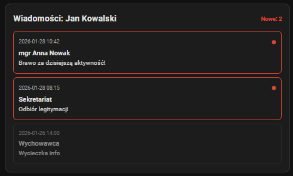
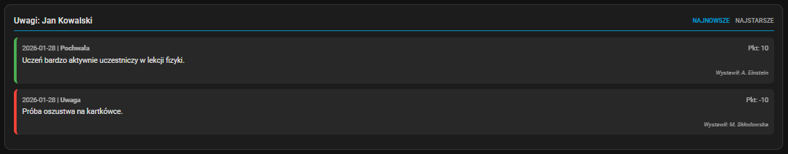
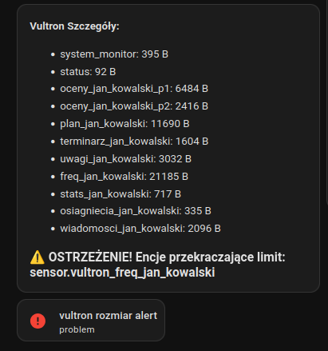
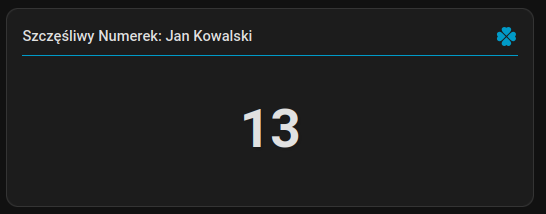

[](https://my.home-assistant.io/redirect/supervisor_add_addon_repository/?repository_url=https%3A%2F%2Fgithub.com%2Fhtomasz%2Fvultron)


[](https://github.dev/htomasz/vultron)


[](https://scorecard.dev/viewer/?uri=github.com/htomasz/vultron)


[-2ea44f?style=flat-square&logo=sigstore&logoColor=white)](https://github.com/htomasz/vultron/attestations)
![Vultron](https://img.shields.io/badge/Vultron-Twój%20asystent%20w%20byciu%20zajebistym%20rodzicem-black?style=flat-square&logo=)

<p align="center">
  
<br><b>Używanie projektu jest jawnym łamaniem regulaminu EduVulcan.pl. <br>Nie rób tego.</b>
</p>

> &nbsp;
> # ⚠️ BARDZO WAŻNE: KROKI PRZED INSTALACJĄ
>
> ### Aby aplikacja zadziałała prawidłowo, musisz najpierw wykonać te 3 kroki:
> ### 1. Zaloguj się na swoje konto przez stronę `WWW`.
> ### 2. Zaakceptuj nowe regulaminy i zgody (cookies).
> ### 3. Przełącz się na profil **KAŻDEGO** ze swoich dzieci i kliknij w dowolną zakładkę (cokolwiek!).
>
> ### 🛑 DOPIERO WTEDY MOŻESZ ZAINSTALOWAĆ APLIKACJĘ! 🛑
>
> ### ⛔ **UWAGA:** Problemy wynikające z pominięcia tych kroków nie są błędami aplikacji. Prosimy nie zakładać zgłoszeń (Bug / Issue), jeśli nie wykonałeś powyższej instrukcji. Szanujmy swój czas i Wasz!
> &nbsp;


# Vultron (Garn)
**Vultron** to **totalnieNIEzaawansowana** integracja Home Assistant z systemem dziennika elektronicznego **EduVulcan.pl**. Dodatek został zaprojektowany, aby dostarczać rodzicom i uczniom kluczowe informacje o edukacji w sposób przejrzysty, zautomatyzowany i bezpieczny.

Konta GPE Gdańsk mogą korzystać z opcjonalnego dostawcy `gdansk`. Konfigurację GPE, obsługiwane dane i ograniczenia opisuje ten dokument: [PL](https://github.com/htomasz/vultron/blob/main/GDANSK.pl.md) | [EN](https://github.com/htomasz/vultron/blob/main/GDANSK.md). Domyślnie nadal używany jest eduVULCAN.

## 🙏 Co-authored-by:
- AI - *każde* :D
- Tomasz H.
- [@KamillJot](https://github.com/KamillJot) — wsparcie dla [GPE Gdańsk](GDANSK.md)

##
 **Wersja:** 7.2.1 \
**Nazwa Kodowa:** [Garn](https://en.wikipedia.org/wiki/Space_adaptation_syndrome#:~:text=Garn%20scale) 🚀🚀


# 📖 Spis treści
* [🚨 Achtung](#-achtung-achtung-)
* [🧩 Changelog](#-changelog)
* [✨ Główne Funkcje](#-główne-funkcje)
* [🏗️ Architektura Systemu](#️-architektura-systemu)
* [🚀 Instalacja](#-instalacja)
* [🐳 Samodzielny kontener Docker](#-samodzielny-kontener-docker)
* [⚙️ Konfiguracja](#️-konfiguracja)
* [📊 Konfiguracja Kart Dashboardu](#-konfiguracja-kart-dashboardu)
* [🔄 Automatyzacja](#-automatyzacja)
* [🔍 Monitoring](#-monitoring)
* [📸 Próbki/screenshoty](#-próbkiscreenshoty)
* [🪲 Zgłaszanie błędów](#-zgłaszanie-błędów-i-bezpieczeństwo)
* [🗑️ Odinstalowanie](#️-odinstalowanie)
* [⚖️ Nota prawna](#️-nota-prawna)


## 🚨🚨🚨 Achtung Achtung 🚨🚨🚨
**Przy pierwszym uruchomieniu ZALECANE śledzenie zakładki LOGI**
czy proces logowania przechodzi poprawnie.

**Dodatek sam się zatrzymuje w trzech sytuacjach:**
- **eduVULCAN dwa razy z rzędu odrzuci logowanie** (złe hasło albo weryfikacja). Dodatek przestaje wtedy próbować, żeby nie zablokować konta. **Dodatek HA:** kończy pracę i zostaje zatrzymany do ręcznego uruchomienia. **Docker:** kontener dalej działa, ale już się nie loguje (dzięki temu `restart: unless-stopped` nie powtarza prób). Popraw dane w `data/options.json` i zrób `docker compose restart`.
- **Przeglądarka (Chromium) się zawiesi.** Proces kończy się wtedy twardo. W Dockerze kontener wstaje sam. W dodatku HA wstanie sam tylko z włączonym przełącznikiem **Watchdog** (karta dodatku → Informacje), inaczej trzeba go uruchomić ręcznie.
- **Synchronizacja wiadomości trzy razy z rzędu przekroczy 10 minut.** Proces kończy się twardo, a restart działa tak samo jak przy zawieszonej przeglądarce.

Licznik odrzuconych logowań jest tylko w pamięci. Każde ponowne uruchomienie dodatku lub kontenera (ręczne; w Dockerze także restart hosta) daje znowu dwie próby logowania, więc przed startem popraw dane.

Zwykłe, chwilowe błędy portalu (np. przerwa techniczna, błąd 502) nie zatrzymują dodatku. Jeśli nie uda się zalogować, kolejna próba nastąpi w następnym cyklu; od drugiej nieudanej próby z rzędu przerwa się wydłuża. Błąd przy pobieraniu danych po udanym logowaniu nie wydłuża przerwy.

**GPE Gdańsk** (`provider: gdansk`) działa inaczej. Za błąd logowania uznaje nie tylko złe hasło, ale też zbyt wolną odpowiedź portalu po zalogowaniu i wygasłą sesję. **Dodatek HA** zatrzymuje się po pierwszym takim błędzie. **Docker** ponawia raz w następnym cyklu, a po drugim błędzie z rzędu działa dalej bez logowania do `docker compose restart`. Stan pokazuje `sensor.vultron_gdansk_status`. Szczegóły: [GDANSK.pl.md](GDANSK.pl.md).

**Przed ponownym startem:**
Sprawdź ręcznie logowanie w oryginalnym dzienniku przez W W W.

## 🧩 Changelog

📝  [Changelog](vultron/CHANGELOG.md)

## ✨ Główne Funkcje

- 👨‍👩‍👧‍👦 **Multi-Student Support:** Automatyczne wykrywanie wszystkich(wszystkie dzieci nasze są) dzieci przypisanych do konta rodzica. Każde dziecko otrzymuje własny zestaw sensorów (np. `adam_nowak`, `jan_kowalski`).
- 📅 **Profesjonalny Plan Lekcji:** Klasyczny układ tabelaryczny z nawigacją tygodniową (poprzedni / obecny / następny — łącznie 3 tygodnie). Możliwość dodawania własnych zajęć. Opisane w [Changelog](vultron/CHANGELOG.md) 6.4.0
- 📈 **Monitoring Ocen:** Śledzenie ocen cząstkowych z systemem powiadomień o nowych wpisach i zmianach. Zakładka **KOŃCOWE** pokazuje oceny proponowane i końcowe z automatycznie wyliczonymi średnimi (bez Zachowania).
- 💬 **Uwagi i Pochwały:** Pełny wgląd w zachowanie ucznia z podziałem na wpisy pozytywne, negatywne oraz informacyjne.
- ✉️ **Centrum Wiadomości:** Licznik wiadomości nieprzeczytanych i wszystkich wraz z listą ostatnich nadawców i tematów.
- 🎒 **Terminarz Wydarzeń:** Podgląd sprawdzianów, kartkówek i zadań domowych z kolorystycznym rozróżnieniem priorytetów.
- ✔️ **Frekwencja:** Szczegółowe informacje o frekwencji na zajęciach.
- 🏆 **Osiągnięcia:** Szczegółowe informacje o osiągnięciach.
- 👩‍🏫 **Zebrania:** Szczegółowe informacje o zebraniach.
- 🧸 **Przedszkole:** Osobny zestaw sensorów dla kont przedszkolnych (wykrywane automatycznie, całkowicie niezależnie od uczniów szkół) — plan zajęć, ewidencja obecności (kalendarz miesięczny + godziny wejścia/wyjścia), jadłospis (skład i alergeny), zebrania, opłaty, informacje o placówce, nauczyciele, wiadomości.
- 📊 **Monitoring:** Dedykowana encja `binary_sensor.vultron_rozmiar_alert` ostrzega, gdy atrybuty którejkolwiek encji zbliżają się do limitu 16 384 B — powyżej niego recorder Home Assistant przestaje zapisywać atrybuty encji w historii (w logu HA pojawia się ostrzeżenie „exceed maximum size of 16384 bytes”).
- 🛠️ **Zero-Click UI:** Dodatek automatycznie rejestruje wymagane karty JavaScript w zasobach Lovelace (Resources) przy każdym starcie.
- 🕵️ **System Anty-Detekcyjny:**
  - Harmonogram poniżej dotyczy eduVULCAN. GPE Gdańsk pobiera co 40-60 min także w weekendy, z przerwą nocną 01:00-06:00 codziennie.
  - Zapytania do serwerów Vulcan wysyłane są w losowych odstępach (40-60 min) w dni robocze.
  - **Weekendy:** pobieranie tylko o stałych porach (sobota 8:00, 16:00, 23:00; niedziela 8:00, 12:00, 20:00).
  - **Tryb Nocny:** Całkowite wstrzymanie aktywności między 01:00 a 05:59.
  - Od drugiego nieudanego logowania z rzędu przerwa wydłuża się o 10 min za każde kolejne (maks. +60 min).
- 📝 **Precyzyjne Logowanie:** Wszystkie zdarzenia logowane są z timestampem w formacie `[YYYY-MM-DD HH:MM:SS]`.


## 🏗️ Architektura Systemu

System opiera się na modularnej strukturze współpracujących funkcji:

| Moduł | Role | Opis techniczny |
| :--- | :--- | :--- |
| `vultron.py` | 🔑 Logowanie <br>📝 Oceny <br>💬 Uwagi <br>✉️ Wiadomości <br>📅 Plan lekcji <br>🎒 Zadania <br>✔️ Frekwencja <br>🏆 Osiągnięcia <br>📊 Monitoring <br>🎨 UI Setup <br>⚙️ Orkiestrator <br> 👩‍🏫 Zebrania <br>🧸 Przedszkole <br>| Główny silnik aplikacji. Obsługuje logowanie **Selenium Headless** (Panel Rodzica + Panel Wiadomości), ekstrakcję kluczy sesji (`key`), pobieranie ocen, uwag, wiadomości, planu lekcji, zadań, frekwencji i osiągnięć. Automatycznie rozpoznaje konta przedszkolne i przetwarza je osobną ścieżką (plan zajęć, ewidencja obecności, jadłospis, zebrania, opłaty, informacje o placówce, nauczyciele). Zarządza bazą **SQLite** (`vultron.db`), monitoringiem zasobów, automatyczną rejestracją kart w Home Assistant oraz pętlą czasową z mechanizmem anty-detekcji. |
| `gdansk.py` | 🏫 **GPE Gdańsk** | Opcjonalny dostawca danych GPE/UONET+ (wybierany opcją `provider`). Ma własne logowanie i API, osobne od eduVULCAN. Opis: [PL](GDANSK.pl.md) / [EN](GDANSK.md). |
| `translations/pl.yaml` | 🌐 **Interfejs** | Polskie nazwy i opisy opcji w zakładce Konfiguracja dodatku. |
| `vultron-card.js` | 🎨 **Stylizacja** | Karta Lovelace — plan lekcji. |
| `vultron-grades-card.js` | 🎨 **Stylizacja** | Karta Lovelace — oceny (widoki: PRZEDMIOTY, NAJNOWSZE, KOŃCOWE). |
| `vultron-messages-card.js` | 🎨 **Stylizacja** | Karta Lovelace — wiadomości. |
| `vultron-stats-card.js` | 🎨 **Stylizacja** | Karta Lovelace — frekwencja. |
| `vultron-osiagniecia-card.js` | 🎨 **Stylizacja** | Karta Lovelace — osiągnięcia. |
| `vultron-uwagi-card.js` | 🎨 **Stylizacja** | Karta Lovelace — uwagi i pochwały. |
| `vultron-work-card.js` | 🎨 **Stylizacja** | Karta Lovelace — zadania domowe i sprawdziany. |
| `vultron-zebrania-card.js` | 🎨 **Stylizacja** | Karta Lovelace — zebrania. |
| `vultron-przedszkole-plan-card.js` | 🎨 **Stylizacja** | Karta Lovelace — plan zajęć przedszkola. |
| `vultron-przedszkole-obecnosc-card.js` | 🎨 **Stylizacja** | Karta Lovelace — obecność przedszkola (kalendarz miesięczny + godziny). |
| `vultron-przedszkole-jadlospis-card.js` | 🎨 **Stylizacja** | Karta Lovelace — jadłospis przedszkola (skład, alergeny). |
| `vultron-przedszkole-zebrania-card.js` | 🎨 **Stylizacja** | Karta Lovelace — zebrania przedszkola. |
| `vultron-przedszkole-oplaty-card.js` | 🎨 **Stylizacja** | Karta Lovelace — opłaty przedszkola. |
| `vultron-przedszkole-informacje-card.js` | 🎨 **Stylizacja** | Karta Lovelace — informacje o placówce przedszkolnej. |
| `vultron-przedszkole-nauczyciele-card.js` | 🎨 **Stylizacja** | Karta Lovelace — nauczyciele przedszkola. |
| `vultron-przedszkole-wiadomosci-card.js` | 🎨 **Stylizacja** | Karta Lovelace — wiadomości przedszkola. |
| `automation/node-red` | 🔄 **Automatyzacje** | Przykładowe przepływy Node-RED. |
| `automation/ha` | 🔄 **Automatyzacje** | Przykładowe natywne automatyzacje Home Assistant. |
| `automation/blueprints` | 🔄 **Automatyzacje** | Przykładowe blueprinty automatyzacji. |
| `lovelace/` | 🎨 **Stylizacja** | Przykładowe konfiguracje kart Lovelace. Zamiast *** wstaw osobe imie_nazwisko |
| `vultron-szczesliwy-numerek-card.js` | 🎨 **Stylizacja** | Karta Lovelace — szczęśliwy numerek. |


## 🚀 Instalacja

Vultron jest dostępny jako standardowe repozytorium Home Assistant.

### 🚨 Metoda 1: Automatyczna (Zalecana)

Kliknij poniższy przycisk, aby dodać repozytorium do swojego Home Assistanta jednym kliknięciem:

[](https://my.home-assistant.io/redirect/supervisor_add_addon_repository/?repository_url=https%3A%2F%2Fgithub.com%2Fhtomasz%2Fvultron)

### 🚨 Coś popsuli w HA :D
Jeżeli powyższy link nie działa, użyj:
Ustawienia → Aplikacje → Sklep z aplikacjami → ⋮ → Repozytoria → wpisz URL <https://github.com/htomasz/vultron> → Dodaj

Po dodaniu repozytorium, wejdź w **Ustawienia → Dodatki → Sklep z dodatkami**, wyszukaj **Vultron** i kliknij **Zainstaluj**.

<br>

<details>
<summary><b>Metoda 2: Ręczna / Deweloperska (SSH)</b></summary>

<br>

Jeśli wolisz zainstalować dodatek ręcznie przez konsolę:

1. Zainstaluj dodatek [SSH & Web Terminal](https://github.com/hassio-addons/addon-ssh).
2. Po instalacji wyłącz **Protection mode** oraz włącz **Show in sidebar**.
3. Wejdź w dodatek SSH i przejdź do folderu addons:
   ```bash
   cd /addons
   ```
4. Sklonuj repozytorium:
   ```bash
   git clone https://github.com/htomasz/vultron.git
   ```
5. W interfejsie HA przejdź do **Ustawienia → Dodatki → Sklep z dodatkami**, kliknij trzy kropki (prawy górny róg) i wybierz **Odśwież**.

</details>

---

### 💾 Wymagania sprzętowe (ważne dla Raspberry Pi)

Vultron w tle uruchamia headless Chromium (Selenium) do logowania w dzienniku - to najbardziej wymagający pamięciowo fragment całego dodatku. Na **Raspberry Pi 4 z 2GB RAM bez skonfigurowanego swapu/zram** obserwowaliśmy sporadyczne zawieszenia logowania pod większym obciążeniem pamięci (inne dodatki, integracje HA działające równolegle).

**Zalecenie:** jeśli Twoje urządzenie ma 2GB RAM, włącz **zram** (kompresowany swap w pamięci RAM - szybszy i nie zużywa karty SD, w przeciwieństwie do tradycyjnego swapu na pliku). To ustawienie na poziomie systemu Home Assistant OS, nie samego dodatku - najprościej przez dodatek [zram / swap](https://github.com/hassio-addons/addon-zram) ze społecznościowego repozytorium, ewentualnie ręcznie z poziomu SSH. Vultron sam w sobie nie potrafi tego skonfigurować z poziomu kontenera.

Dodatek od wersji 7.0.1 sam potrafi wykryć i posprzątać po zawieszonej przeglądarce (żeby jedna awaria nie eskalowała do wyczerpania pamięci na całym urządzeniu), ale przy bardzo ciasnym budżecie RAM-u pojedyncze, odosobnione timeouty logowania wciąż mogą się zdarzać - to fizyczne ograniczenie sprzętu, nie błąd dodatku.

---
## 🐳 Samodzielny kontener Docker

Dla osób, które mają Home Assistant uruchomiony jako zwykły kontener Docker (bez tzw. "Supervisora"). Vultron działa wtedy jako osobny kontener obok Home Assistanta.

📘 **Instrukcja krok po kroku:** [DOCKER.md](DOCKER.md)

---

## ⚙️ Konfiguracja

W zakładce **Konfiguracja** zainstalowanego dodatku wypełnij dane dostępowe:

| Parametr | Opis | Przykład |
| :--- | :--- | :--- |
| `Portal dziennika` (`provider`) | `eduvulcan` (domyślnie) albo `gdansk` (GPE/UONET+, patrz [PL](GDANSK.pl.md) / [EN](GDANSK.md)). | `eduvulcan` |
| `Imię i nazwisko ucznia` (`student_name`) | Tylko dla GPE: dokładne imię i nazwisko. Puste pobiera wszystkich uczniów. Dla eduVULCAN jest ignorowane. | |
| `username` | eduVULCAN: adres e-mail. GPE Gdańsk: login konta podany przy rejestracji (może różnić się od adresu e-mail). | `rodzic@email.pl` |
| `password` | Hasło do portalu | `TwojeTajneHasło` |
| `Poziom logowania` | Określa szczegółowość logów w zakładce Logi. Domyślnie: info. `trace` zapisuje do logu pełne odpowiedzi dziennika (oceny, uwagi, treści wiadomości) - używaj tylko do diagnozy i wyłącz po niej. Log trafia też do pliku `/data/vultron.log` (bieżący plik + 5 kopii po 1 MB) i zostaje tam po wyłączeniu `trace`. | `info`,`debug`,`trace` (nie rozumiesz, nie zmieniaj)|
| `Tryb testowy` | Pomija przerwy z harmonogramu (nocne i weekendowe godziny pobierania). Odstęp 40-60 minut między pobraniami zostaje. Używaj tylko do testowania modyfikacji! | `true`,`false` (nie rozumiesz, nie zmieniaj) |

1. Kliknij **Zapisz**.
2. Kliknij **Uruchom**.

**Ważne:** Przy pierwszym uruchomieniu zalecane jest śledzenie zakładki **Logi**, aby upewnić się, że proces logowania przebiega pomyślnie. Skrypt posiada zabezpieczenie: jeśli eduVULCAN dwa razy odrzuci logowanie (złe hasło lub weryfikacja) bez udanego logowania pomiędzy, dodatek się zatrzymuje, chroniąc Twoje konto przed blokadą. `sensor.vultron_status` ma wtedy stan `authentication_error`. W Dockerze kontener dalej działa, ale już się nie loguje. Popraw `data/options.json` i zrób `docker compose restart` (patrz „Achtung” wyżej). Stan synchronizacji i ostatni błąd pokazuje encja `sensor.vultron_status` (`ok` / `error` / `authentication_error`). Chwilowe awarie portalu (przerwa techniczna, błąd serwera) nie zatrzymują dodatku - kolejna próba nastąpi w następnym cyklu (przy powtarzających się nieudanych logowaniach z wydłużoną przerwą).

> ℹ️ Opcja `calendar_entity` (nazwa kalendarza z własnymi zajęciami, domyślnie `calendar.local_szkola`) działa tylko w instalacji Docker: dopisz ją do `data/options.json`. W dodatku HA nie ma jej w interfejsie, więc używana jest domyślna nazwa.

---

### 💡 Ważna uwaga dotycząca kart UI i odświeżania

Z powodu sposobu, w jaki Home Assistant oraz przeglądarki internetowe zarządzają plikami interfejsu (Lovelace), po instalacji dodatku lub jego aktualizacji możesz napotkać problemy z wyświetlaniem kart (np. błąd `Custom element doesn't exist` lub brak nowych funkcji).

Oto jak sobie z tym poradzić:

#### 1. "Zwykłe" Odświeżanie vs "Twarde" Odświeżanie
Przeglądarki często przechowują starą wersję plików `.js`, aby przyspieszyć ładowanie strony. Jeśli karta nie wygląda tak, jak powinna:
*   **Na komputerze:** Użyj kombinacji **`Ctrl + F5`** (Windows/Linux) lub **`Cmd + Shift + R`** (Mac). Wymusza to na przeglądarce ponowne pobranie plików z serwera Home Assistant zamiast czytania ich z dysku.
*   **W aplikacji mobilnej:** Zamknij całkowicie aplikację Home Assistant i uruchom ją ponownie. Możesz również wejść w *Ustawienia → Aplikacja towarzysząca → Debugowanie → Wyczyść pamięć podręczną*.

#### 2. Kiedy wyczyścić ciasteczka i dane strony?
Jeśli "Twarde odświeżanie" nie pomaga, może to oznaczać, że w pamięci podręcznej przeglądarki utknął błędny stan zasobów.
*   W takim przypadku zalecane jest wyczyszczenie danych podręcznych dla adresu IP/domeny Twojego Home Assistanta.
*   **Wskazówka:** Często najszybszym testem jest otwarcie panelu w **trybie Inkognito**. Jeśli tam karty działają poprawnie, oznacza to, że Twoja główna sesja przeglądarki wymaga czyszczenia cache.

#### 3. Rejestracja Zasobów
Dodatek posiada wbudowaną funkcję `run_setup_ui()` (część `vultron.py`), która automatycznie dodaje karty do zasobów Lovelace przy każdym starcie. Home Assistant czasami potrzebuje chwili (lub restartu interfejsu), aby "zauważyć" nową ścieżkę `/local/vultron/vultron-*.js`. Jeśli po instalacji nie widzisz kart, przejdź do:
`Ustawienia → Pulpity sterujące → Trzy kropki → Zasoby`
i upewnij się, że wpisy dla Vultrona są obecne na liście.

## 📊 Konfiguracja Kart Dashboardu

Po uruchomieniu dodatku sensory zostaną utworzone automatycznie (np. `sensor.vultron_oceny_jan_kowalski`). Dodaj nową kartę (Manual Card) na swoim Dashboardzie, korzystając z poniższych wzorów:

### 📅 Plan Lekcji (Tabelaryczny z nawigacją)
```yaml
type: custom:vultron-card
entity: sensor.vultron_plan_jan_kowalski_curr
freq_entity: sensor.vultron_freq_jan_kowalski
```
#### 🔜 Automatyczny podgląd następnego tygodnia (opcjonalnie)

Domyślnie karta pokazuje bieżący tydzień (do niedzieli). Jeśli chcesz, żeby od określonego dnia i godziny sama pokazała plan na następny tydzień (np. od piątku wieczorem), dodaj `next_week_from`:

```yaml
type: custom:vultron-card
entity: sensor.vultron_plan_jan_kowalski_curr
freq_entity: sensor.vultron_freq_jan_kowalski
next_week_from:
  day: pt     # pon, wt, sr, czw, pt, sob, nie
  hour: 20    # godzina 0-23; pominięta = od północy
```

| Pole | Wartości | Znaczenie |
|---|---|---|
| `day` | `pon`, `wt`, `sr`, `czw`, `pt`, `sob`, `nie` | dzień, od którego karta przełącza się na następny tydzień |
| `hour` | `0`–`23` (opcjonalnie, domyślnie `0`) | godzina w tym dniu |

- Gdy karta przełączy się sama, w nagłówku pojawi się znacznik **`[SYMULATOR]`**, żeby było jasne, że to automatyczny podgląd następnego tygodnia, a nie bieżący tydzień.
- Przełączenie obowiązuje do poniedziałku 00:00. Przyciskami nawigacji nadal można przejść do innego tygodnia.
- To zmiana wyłącznie wyglądu karty: nie wpływa na dane ani na sensory.
- Stan jest sprawdzany przy załadowaniu karty. Pulpit otwarty od piątku 19:00 przełączy się dopiero po odświeżeniu strony.
- Opcja działa tylko w `vultron-card` (plan szkolny). W karcie planu przedszkola jej nie ma.


### 🗓️ Plan Lekcji — własne zajęcia z kalendarza HA (opcjonalnie)

Zajęcia pozaszkolne (basen, angielski, korepetycje) możesz dodać do planu zwykłym kalendarzem Home Assistant — pojawią się na karcie planu obok lekcji ze szkoły, z turkusową plakietką **„Z kalendarza"**.

**1. Kalendarz.** Utwórz w HA kalendarz o nazwie encji `calendar.local_szkola` (integracja *Local Calendar*: Ustawienia → Urządzenia i usługi → Dodaj integrację → *Local Calendar*, nazwa kalendarza: `local_szkola`).

**2. Format wydarzenia.** Tytuł musi zaczynać się od imienia dziecka i dwukropka:

| Tytuł wydarzenia | Efekt |
|---|---|
| `Jan: Basen` | zajęcia „Basen" dla Jana |
| `Jan Kowalski: Dodatkowy angielski` | to samo, z pełnym imieniem i nazwiskiem |

- Imię musi zgadzać się z imieniem ucznia w eduVULCAN. Wielkość liter i polskie znaki nie mają znaczenia (`jan:`, `jan kowalski:` też zadziała). Samo nazwisko (`Kowalski:`) nie zadziała.
- Jeśli masz dwoje dzieci o tym samym imieniu, używaj pełnego `Imię Nazwisko:`.
- **Lokalizacja** wydarzenia → sala, **Opis** → notatka (widoczna w podpowiedzi).
- Wydarzenie musi mieć konkretną godzinę startu i końca. Wydarzenia całodniowe są pomijane. Najlepiej trzymać się godzin lekcyjnych planu, żeby wpis trafił do tego samego wiersza tabeli.
- Wydarzenia cykliczne („co wtorek") działają.
- Wydarzenia bez prefiksu `Imię:` są ignorowane (inne rzeczy w kalendarzu nie przeszkadzają).

**3. Zakres i limity.** Pobierane jest to samo okno co plan: od poniedziałku poprzedniego tygodnia do 21 dni od dziś (karta pokazuje poprzedni, obecny i następny tydzień). Limit to 200 zajęć na ucznia w tym oknie. Edycja i usunięcie wydarzenia w kalendarzu synchronizuje się przy kolejnym cyklu.

> ℹ️ Funkcja jest w pełni opcjonalna. Brak kalendarza lub jego niedostępność nie wpływa na resztę synchronizacji. Diagnostyka: w logu dodatku szukaj linii `Kalendarz calendar.local_szkola: pobrano X wydarzeń, dopasowano Y`.


### 📈 Oceny Cząstkowe
```yaml
type: custom:vultron-grades-card
entity: sensor.vultron_oceny_jan_kowalski_p2 # tu sensor ma p1 okres 1 i p2 okres 2
default_sort: date   # date, subject albo final
limit: 10   #0 - pokazuje wszystkie (dotyczy widoku NAJNOWSZE)
```

Karta posiada trzy widoki:
- **PRZEDMIOTY** — oceny pogrupowane według przedmiotu ze średnią oraz ocenami proponowaną i końcową
- **NAJNOWSZE** — wszystkie oceny posortowane chronologicznie
- **KOŃCOWE** — oceny proponowane i końcowe w postaci cyfr (1–6) dla wszystkich przedmiotów wraz ze średnimi (bez Zachowania)

### ✉️ Wiadomości (Licznik i Lista)
```yaml
type: custom:vultron-messages-card
entity: sensor.vultron_wiadomosci_jan_kowalski
limit: 10   #0 - pokazuje wszystkie
```

### 💬 Uwagi i Pochwały
```yaml
type: custom:vultron-uwagi-card
entity: sensor.vultron_uwagi_jan_kowalski
default_sort: desc or asc
limit: 10   #0 - pokazuje wszystkie
```

### 🎒 Terminarz (Sprawdziany i Zadania)
```yaml
type: custom:vultron-work-card
entity: sensor.vultron_terminarz_jan_kowalski
default_sort: desc or asc
limit: 10   #0 - pokazuje wszystkie
```

### ✔️  Frekwencja
```yaml
type: custom:vultron-stats-card
entity: sensor.vultron_stats_jan_kowalski
```

### 👩‍🏫 Zebrania
```yaml
type: custom:vultron-zebrania-card
entity: sensor.vultron_zebrania_jan_kowalski
limit: 10   #0 - pokazuje wszystkie
```

### 🧸 Przedszkole — Plan Zajęć (Tabelaryczny z nawigacją)
```yaml
type: custom:vultron-przedszkole-plan-card
entity: sensor.vultron_przedszkole_plan_jan_kowalski_curr
```
Karta sama dogrywa `_prev`/`_next` przy przełączaniu strzałkami - w konfiguracji podajesz tylko encję z sufiksem `_curr`, ale wszystkie trzy encje (`_prev`, `_curr`, `_next`) muszą istnieć dla danego dziecka.

Każdy dzień (Pon–Pt) to kolumna z listą zajęć po kolei - przedszkole ma nieregularne, nakładające się godziny, więc nie ma wspólnej siatki godzin jak w planie szkolnym. W bieżącym tygodniu zajęcia trwające właśnie teraz mają znacznik „TERAZ", a w kolumnie dzisiejszej żółta kreska z godziną oddziela zajęcia już rozpoczęte od tych, które dopiero się zaczną.

### 🧸 Przedszkole — Obecność (Kalendarz miesięczny + godziny)
```yaml
type: custom:vultron-przedszkole-obecnosc-card
entity: sensor.vultron_przedszkole_obecnosc_jan_kowalski
```
Zakładka "Kalendarz" pokazuje 31 ostatnich dni zapisanych w bazie (tylko dni robocze Pon-Pt, weekendy pominięte) z możliwością przeglądania miesięcy. Zakładka "Godziny" pokazuje zawsze bieżący miesiąc z dokładną godziną wejścia/wyjścia i wyliczonym czasem pobytu.

### 🧸 Przedszkole — Jadłospis
```yaml
type: custom:vultron-przedszkole-jadlospis-card
entity: sensor.vultron_przedszkole_jadlospis_jan_kowalski
```
Zakładki Dziś/Jutro, posiłki rozwijane po kliknięciu (skład i alergeny). Wartości odżywcze celowo nieuwzględnione — przekraczały limit rozmiaru encji Home Assistant.

### 🧸 Przedszkole — Zebrania
```yaml
type: custom:vultron-przedszkole-zebrania-card
entity: sensor.vultron_przedszkole_zebrania_jan_kowalski
limit: 10   #0 - pokazuje wszystkie
```

### 🧸 Przedszkole — Opłaty
```yaml
type: custom:vultron-przedszkole-oplaty-card
entity: sensor.vultron_przedszkole_oplaty_jan_kowalski
```
Ze względów bezpieczeństwa numer konta bankowego i tytuł przelewu NIE są publikowane jako atrybuty encji (trafiają wyłącznie do lokalnej bazy `vultron.db`) — karta pokazuje tylko kwoty i status.

### 🧸 Przedszkole — Informacje o placówce
```yaml
type: custom:vultron-przedszkole-informacje-card
entity: sensor.vultron_przedszkole_informacje_jan_kowalski
```

### 🧸 Przedszkole — Nauczyciele
```yaml
type: custom:vultron-przedszkole-nauczyciele-card
entity: sensor.vultron_przedszkole_nauczyciele_jan_kowalski
```

### 🧸 Przedszkole — Wiadomości
```yaml
type: custom:vultron-przedszkole-wiadomosci-card
entity: sensor.vultron_przedszkole_wiadomosci_jan_kowalski
limit: 10   #0 - pokazuje wszystkie
```

### 🍀 Szczęśliwy Numerek
```yaml
type: custom:vultron-szczesliwy-numerek-card
entity: sensor.vultron_szczesliwy_numerek_jan_kowalski
```

### 🏆 Osiągnięcia
```yaml
type: custom:vultron-osiagniecia-card
entity: sensor.vultron_osiagniecia_jan_kowalski
limit: 10   #0 - pokazuje wszystkie
```
mozna też użyć
```yaml
- type: gauge
  entity: sensor.vultron_stats_jan_kowalski
  min: 0
  max: 100
  name: Frekwencja Jan Kowalski
  needle: true
  severity:
    green: 80
    yellow: 50
    red: 0
```
## 🔍 Monitoring
`sensor.vultron_status` (eduVULCAN) i `sensor.vultron_gdansk_status` (GPE Gdańsk) pokazują stan ostatniej synchronizacji: `ok`, `error` (chwilowy problem - kolejna próba nastąpi sama) albo `authentication_error` (logowanie odrzucone - sprawdź login i hasło; kiedy dodatek się zatrzymuje, opisuje „Achtung” wyżej). GPE ma dodatkowo stan `partial` (część sekcji się nie pobrała, lista w atrybucie `errors`). Atrybut `error` zawiera opis błędu, a `last_success` czas ostatniej udanej synchronizacji (w GPE tylko przy stanie `ok` i `partial`).

Jeśli lista w encji (uwagi, zebrania, terminarz, osiągnięcia) nie mieści się w limicie Home Assistanta, najstarsze wpisy są pomijane, a atrybut `pominiete` mówi ile. Stan encji nadal pokazuje pełną liczbę wpisów. W wiadomościach lista zostaje cała (10 ostatnich), a przy braku miejsca znika tylko treść najstarszych nieprzeczytanych (atrybut `skrocone` mówi ile; karta pokazuje wtedy informację, że treść nie zmieściła się w Home Assistant). Pełna treść jest w eduVULCAN.

`sensor.vultron_system_monitor` pokazuje w stanie sumaryczny rozmiar atrybutów wszystkich encji `sensor.vultron_*`, a w atrybucie `szczegoly` rozmiar każdej z nich osobno. Rozmiar to długość tekstu JSON atrybutów liczona przez szablon Home Assistanta, czyli przybliżenie liczby bajtów. `binary_sensor.vultron_rozmiar_alert` ma stan `on`, gdy którakolwiek encja przekroczy **15 500** (limit recordera Home Assistant to 16 384 B). Cel: wykryć duże encje, zanim recorder HA przestanie zapisywać ich atrybuty w historii. Obie encje tworzą się i odświeżają automatycznie po każdym cyklu.

```yaml
sensor.vultron_system_monitor
binary_sensor.vultron_rozmiar_alert
```
Aby zwizualizować wartości monitoringu, użyj karty markdown dla sensor.vultron_system_monitor
```yaml
type: markdown
content: >
  <table>   
    
      
      <tr>
        <td style="padding: 0px 15px 0px 0px; border: none;">{{ dane[0].replace('sensor.vultron_', '') }}</td>
        <td style="padding: 0px; border: none; text-align: right;"><b>{{ dane[1].replace('B', ' B') }}</b></td>
      </tr>
    
    <tr>
      <td colspan="2" style="padding: 4px 0px 0px 0px; border: none; font-size: 0.8em; color: gray;">
        🕐 {{ last_update }}
      </td>
    </tr>
   </table>

   ### ⚠️
  OSTRZEŻENIE! Przekroczono próg 15 500 B dla co najmniej jednej encji. Sprawdź listę powyżej. 
```
aby zwizualizować alarm, użyj karty encji dla binary_sensor.vultron_rozmiar_alert
```yaml
type: tile
entity: binary_sensor.vultron_rozmiar_alert
vertical: false
features_position: bottom
```

### 🔒 Prywatność: historia encji (recorder)
Home Assistant zapisuje w bazie historii każdą zmianę atrybutów encji - także treść wiadomości, uwag i oceny dzieci. Jeśli nie potrzebujesz wykresów historii dla tych encji, wyłącz ich zapis w `configuration.yaml`:

```yaml
recorder:
  exclude:
    entity_globs:
      - sensor.vultron_wiadomosci_*
      - sensor.vultron_przedszkole_wiadomosci_*
      - sensor.vultron_uwagi_*
      - sensor.vultron_oceny_*
```
Automatyzacje i karty działają dalej normalnie (korzystają z bieżącego stanu, nie z historii). Mniejsza baza historii to też mniej zapisów na karcie SD w Raspberry Pi.

## 🔄 Automatyzacja

IMPLEMENTUJ PO TYM JAK DODATEK WYKONA CAŁY JEDEN CYKL bo inaczej wszystko bedzie powiadomieniem.

### 🔄 Automatyzacje (Blueprints)

Zapomnij o ręcznym kopiowaniu kodu YAML. Dzięki **Blueprints (Schematom)** możesz skonfigurować powiadomienia o ocenach, nieobecnościach czy wiadomościach w kilka sekund za pomocą prostego interfejsu graficznego.

#### 🎓 Jak używać?
1. Kliknij przycisk **Importuj** przy wybranym schemacie.
2. Zatwierdź import w swojej instancji Home Assistant.
3. Wybierz odpowiedni sensor Twojego dziecka (np. `sensor.vultron_oceny_jan_kowalski_p1`).
4. W polu **Akcje do wykonania** dodaj akcję powiadomienia (np. `notify.mobile_app_twoj_telefon`) i kliknij **Zapisz**.

---

#### 📦 Vultron Alert Pack

| Funkcja | Opis | Import |
| :--- | :--- | :---: |
| **Nowe Oceny** | Zaawansowane powiadomienia o ocenach (obsługuje wiele ocen naraz). | [](https://my.home-assistant.io/redirect/blueprint_import/?blueprint_url=https%3A%2F%2Fgithub.com%2Fhtomasz%2Fvultron%2Fblob%2Fmain%2Fautomation%2Fblueprints%2Foceny.yaml) |
| **Frekwencja** | Alert o nieobecnościach i spóźnieniach z nazwą przedmiotu z planu. | [](https://my.home-assistant.io/redirect/blueprint_import/?blueprint_url=https%3A%2F%2Fgithub.com%2Fhtomasz%2Fvultron%2Fblob%2Fmain%2Fautomation%2Fblueprints%2Ffrekwencja.yaml) |
| **Zmiana Planu** | Powiadomienia o zastępstwach, odwołanych lekcjach i przeniesieniach. | [](https://my.home-assistant.io/redirect/blueprint_import/?blueprint_url=https%3A%2F%2Fgithub.com%2Fhtomasz%2Fvultron%2Fblob%2Fmain%2Fautomation%2Fblueprints%2Fplan.yaml) |
| **Uwagi i Pochwały** | Informacja o zachowaniu dziecka z automatycznym doborem emoji (`🌟`/`⚠️`). | [](https://my.home-assistant.io/redirect/blueprint_import/?blueprint_url=https%3A%2F%2Fgithub.com%2Fhtomasz%2Fvultron%2Fblob%2Fmain%2Fautomation%2Fblueprints%2Fuwagi.yaml) |
| **Wiadomości** | Powiadomienie o nowej wiadomości od nauczyciela lub dyrekcji. | [](https://my.home-assistant.io/redirect/blueprint_import/?blueprint_url=https%3A%2F%2Fgithub.com%2Fhtomasz%2Fvultron%2Fblob%2Fmain%2Fautomation%2Fblueprints%2Fwiadomosci.yaml) |
| **Sprawdziany i zadania** | Powiadomienie o nowym sprawdzianie, kartkówce, klasówce lub zadaniu domowym w terminarzu (`📝`/`🏠`). | [](https://my.home-assistant.io/redirect/blueprint_import/?blueprint_url=https%3A%2F%2Fgithub.com%2Fhtomasz%2Fvultron%2Fblob%2Fmain%2Fautomation%2Fblueprints%2Fterminarz.yaml) |

---

#### 💡 Personalizacja powiadomień
W sekcji **Akcje** każdego Blueprintf-a możesz używać dynamicznych zmiennych, aby dostosować treść powiadomienia:

*   **Oceny:** `{{ uczen }}`, `{{ przedmiot }}`, `{{ ocena }}`, `{{ opis }}`, `{{ data }}`, `{{ okres }}`
*   **Frekwencja:** `{{ uczen }}`, `{{ wiadomosc }}`
*   **Zmiana Planu:** `{{ uczen }}`, `{{ wiadomosc }}`
*   **Uwagi:** `{{ uczen }}`, `{{ kategoria }}`, `{{ tresc }}`, `{{ autor }}`, `{{ typ }}`, `{{ data }}`, `{{ wiadomosc }}`
*   **Wiadomości:** `{{ uczen }}`, `{{ nadawca }}`, `{{ temat }}`, `{{ data }}`, `{{ wiadomosc }}`
*   **Sprawdziany i zadania:** `{{ uczen }}`, `{{ typ }}`, `{{ przedmiot }}`, `{{ data }}`, `{{ opis }}`, `{{ autor }}`, `{{ ikona }}`, `{{ tytul }}`, `{{ wiadomosc }}`

*Przykład wiadomości:* `{{ uczen }} otrzymał ocenę {{ ocena }} z przedmiotu {{ przedmiot }}!`

### 🛑 Node-RED

Do działania wymagany jest [node-red-contrib-home-assistant-websocket](https://flows.nodered.org/node/node-red-contrib-home-assistant-websocket) dla Node-RED. (najprościej zainstalować poprzez manage-palette)

Poniższe automatyzacje instaluje się poprzez import i wklej :D

W plikach

- [plan.json](./automation/node-red/plan.json#L12-L16) - powiadomienia o zmianach w planie
- [frekwencja.json](./automation/node-red/frekwencja.json#L12-L16) - powiadomienia o zmianach we frekwencji
- [oceny.json](./automation/node-red/oceny.json#L12-L16) - powiadomienia o zmianach w ocenach
- [terminarz.json](./automation/node-red/terminarz.json#L12-L16) - powiadomienia o zmianach w zadaniach domowych/sprawdzianach
- [uwagi.json](./automation/node-red/uwagi.json#L12-L16) - powiadomienia o zmianach w uwagach
- [wiadomosci.json](./automation/node-red/wiadomosci.json#L12-L16) - powiadomienia o nowych wiadomościach
- [patusek.json](./automation/node-red/patusek.json#L12-L16) - wyjście do "odłącz prąd i zablokuj MAC" :D

odszukaj sekcję `entities` i zmień nazwę sensora.

```json
...
[
    {
        "id": "vultron_plan_trigger",
        "type": "server-state-changed",
        "z": "vultron_grades_flow",
        "name": "Zmiana w Planie",
        "server": "a8398b8a.edbcf8",
        "version": 6,
        "outputs": 1,
        "exposeAsEntityConfig": "",
        "entities": {
            "entity": [
                "sensor.vultron_plan_jan_kowalski_curr" <-- TU WPISZ SWOJĄ ENCJE
                moze byc tu druga encja w przypadku planu _curr,_next oraz ocen p1,p2
            ],
            "substring": [],
            "regex": []
        },
...
```

### 🏠 HA Automations

Najprosciej dodać:

Ustawienia → Automatyzacje oraz sceny → Utwórz automatyzację → Utwórz nową automatyzację → ⋮ → Edycja w YAML → Wklej i zmień "entity"

- [plan.yaml](./automation/ha/plan.yaml#L6-L8) - powiadomienia o zmianach w planie
- [frekwencja.yaml](./automation/ha/frekwencja.yaml#L4-L5) - powiadomienia o zmianach we frekwencji
- [oceny.yaml](./automation/ha/oceny.yaml#L5-L7) - powiadomienia o zmianach w ocenach
- [uwagi.yaml](./automation/ha/uwagi.yaml#L4-L5) - powiadomienia o zmianach w uwagach
- [terminarz.yaml](./automation/ha/terminarz.yaml#L5-L6) - powiadomienia o nowych sprawdzianach i zadaniach domowych
- [wiadomosci.yaml](./automation/ha/wiadomosci.yaml#L4-L5) - powiadomienia o nowych wiadomościach

```yaml
...
alias: "Vultron: Alert Frekwencji"
description: ""
triggers:
  - entity_id:
      - sensor.vultron_freq_jan_kowalski <-- TU WPISZ SWOJĄ ENCJE
    attribute: wpisy
    trigger: state
actions:
...
```


## 📸 Próbki/screenshoty

### 📚 Plan lekcji


### 📅 Terminarz


### 📊 Frekwencja


### 📝 Oceny
 

### 💬 Wiadomości


### ⚠️ Uwagi


### 📊 Monitoring


### 🍀 Szczęśliwy Numerek (podgląd)


## ⚠️ Debugowanie
Jeśli napotkasz problemy z logowaniem:
1. Sprawdź zakładkę **Logi** dodatku (Docker: `docker compose logs -f`). Wszystkie błędy są tam opisywane w czasie rzeczywistym.
2. Sprawdź `sensor.vultron_status`: atrybut `error` mówi, co poszło nie tak, a `last_success` kiedy ostatnio się udało.
3. Gdy logowanie do eduVULCAN się nie powiedzie, dodatek zapisuje zrzut ekranu przeglądarki w `/config/www/vultron/` pod losową nazwą `vultron_auth_error_<losowy_ciąg>.png`. Dokładny adres (`/local/vultron/...`) jest w logu dodatku. Nowy zrzut usuwa poprzedni.
   > ⚠️ **Zrzut może zawierać dane prywatne.** Zależnie od momentu błędu widać na nim stronę logowania z wpisanym loginem (adresem e-mail) albo stronę po zalogowaniu, np. wybór profilu z imionami i nazwiskami dzieci. Pliki z `/local/` Home Assistant udostępnia **bez logowania** każdemu, kto zna adres (stąd losowa nazwa). Zrzut nie jest usuwany automatycznie, zostaje do następnego błędu. Po diagnozie usuń plik, a przed wysłaniem w zgłoszeniu zamaż dane.
4. Przy `authentication_error` patrz „Wpisałem złe hasło” w sekcji Docker.

### 🧸 Usuwanie błędnej wiadomości przedszkolaka (po aktualizacji do 7.1.6)
Jeśli przed 7.1.6 do wiadomości przedszkolaka trafiła wiadomość ucznia szkoły, nadal siedzi w bazie. Znajdź ją i usuń (Docker: `docker exec vultron ...`; dodatek HA: nazwę kontenera pokaże `docker ps | grep vultron`):
```bash
docker exec vultron sqlite3 /data/vultron.db "SELECT key, student_slug, data, nadawca, temat FROM przedszkole_wiadomosci;"
docker exec vultron sqlite3 /data/vultron.db "DELETE FROM przedszkole_wiadomosci WHERE key='TUTAJ_KLUCZ';"
```
Przed usuwaniem zrób kopię `/data/vultron.db`. Encja odświeży się przy następnym cyklu.

## 🪲 Zgłaszanie błędów i Bezpieczeństwo

Znalazłeś błąd lub masz pomysł na nową funkcję? Postępuj zgodnie z poniższymi krokami:

1. **Błędy bezpieczeństwa (Security):** Jeśli znalazłeś lukę dotyczącą haseł, sesji, wycieku danych lub prywatności, **NIE OTWIERAJ** publicznego zgłoszenia w Issues. Przeczytaj naszą politykę [🛡️ SECURITY.md](https://github.com/htomasz/vultron/blob/main/SECURITY.md) i postępuj zgodnie z zawartą tam instrukcją prywatnego zgłoszenia.

2. **Błędy techniczne (Bugs):** Jeśli błąd nie dotyczy bezpieczeństwa (np. błąd w planie lekcji, błąd w karcie UI):
   - Sprawdź, czy problem nie został już zgłoszony w [GitHub Issues](https://github.com/htomasz/vultron/issues).
   - Jeśli nie, otwórz nowe zgłoszenie [tutaj](https://github.com/htomasz/vultron/issues).

3. **Sugestie (Features):** Masz pomysł na nową funkcję? Otwórz zgłoszenie typu „Pomysł na funkcję” w zakładce Issues.

4. **Chcesz pomóc w kodzie?** Zajrzyj do [🤝 CONTRIBUTING.md](https://github.com/htomasz/vultron/blob/main/CONTRIBUTING.md) — jak uruchomić testy, gdzie co leży i czego nie wklejać do logów. Zasady zachowania: [📜 CODE_OF_CONDUCT.md](https://github.com/htomasz/vultron/blob/main/CODE_OF_CONDUCT.md).

## 🗑️ Odinstalowanie
Jeśli zdecydujesz się usunąć dodatek:
1. Odinstaluj Vultron w zakładce Dodatki.
2. Ręcznie usuń folder `/config/www/vultron`.
3. Usuń wpisy kart (filtr po vultron_) w `Ustawienia → Pulpity sterujące → Zasoby`

**Docker:** `docker compose down`, usuń foldery `data/` i `secrets/` (zawierają hasło i token), folder `www/vultron` oraz **usuń token** w Home Assistant (Profil → Bezpieczeństwo → Długoterminowe tokeny dostępu).

## ⚖️ Nota prawna
> [!IMPORTANT]
> Projekt **Vultron** jest narzędziem edukacyjnym, tworzonym z myślą o użytku prywatnym (licencja GPL-3.0). Autor nie bierze odpowiedzialności za ewentualne blokady kont, błędy w synchronizacji danych czy inne konsekwencje wynikające z automatyzacji dostępu do portalu EduVulcan.pl. Korzystasz z dodatku na własną odpowiedzialność.

## 🏚️️ Łamanie prawa
> [!IMPORTANT]
> Używanie projektu jest jawnym łamaniem regulaminu EduVulcan.pl. Nie rób tego.
